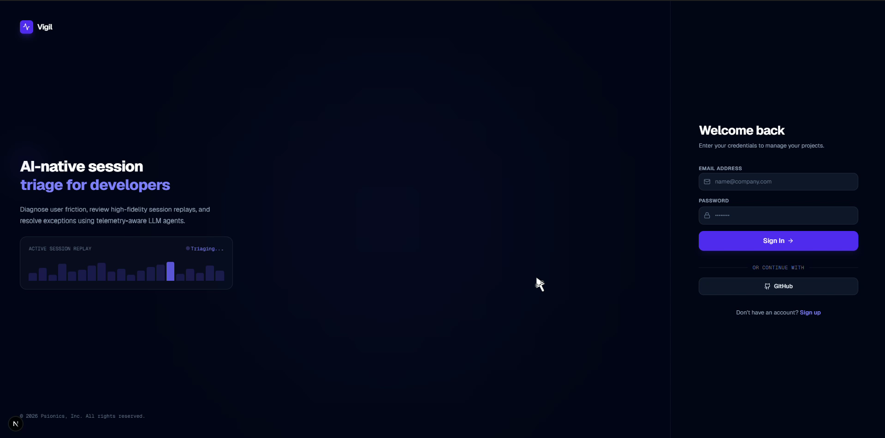
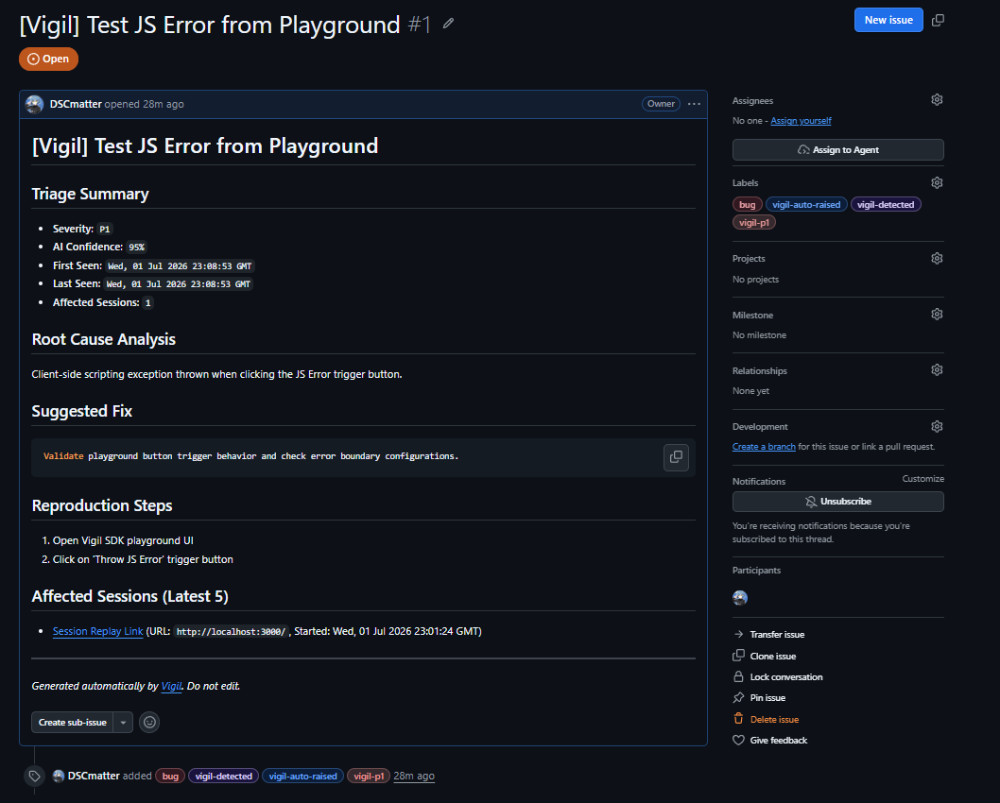

<p align="center">
  
</p>

<p align="center">
  <strong>Vigil</strong><br/>
  AI-first bug triage from real user sessions
</p>

<p align="center">
  <a href="docs/vigil-architecture.md">Architecture</a> ·
  <a href="docs/vigil-product-spec.md">Product Spec</a> ·
  <a href="docs/vigil-data-schema.md">Data Schema</a> ·
  <a href="docs/vigil-sdk-contract.md">SDK Contract</a> ·
  <a href="CONTRIBUTING.md">Contributing</a>
</p>

---

## What is Vigil?

Vigil turns broken user sessions into developer-ready bug reports. It watches real sessions for errors, failed clicks, and network failures. It groups the same failure across users into one issue. Then it opens a GitHub issue with the likely root cause, reproduction steps, a suggested fix, and the evidence behind them.

### Demo

[](https://github.com/Psionic-labs/Vigil/blob/main/demo/demo.mp4)

Example issue created by the GitHub integration:



---

## Why teams use it

Users leave without reporting bugs. Error tools show stack traces with no context. Replay tools show recordings nobody has time to watch. Someone still has to decide what counts as a bug, what is a duplicate, and what to fix first.

Vigil makes those calls. For each session it answers:

- Was the session normal, noisy, or broken?
- What was the user trying to do, and did they finish it?
- What broke, and how do you reproduce it?
- Is this a new bug or one already known?

The result is an issue queue sorted by severity and impact. Developers work from that queue instead of a folder of recordings.

---

## What you get

- One issue per bug. When 500 users hit the same failure, you see one issue with 500 affected sessions.
- Reports you can act on. Each one includes a title, likely root cause, reproduction steps, severity, confidence, and linked evidence.
- GitHub issues raised for you. Vigil opens one issue per issue group, with replay links and affected session counts.
- Automatic filing for critical bugs. Auto-raise files P0 and P1 issues once AI confidence passes your threshold. The setting is off by default.
- Updates when a bug grows. When more sessions attach to an issue that already has a GitHub issue, Vigil posts one batched comment with the new evidence.

---

## How it works

You install a small browser SDK. It records what happens in a session and sends a compact summary to Vigil. The AI triage worker then creates a new issue, attaches the session to an existing one, or ignores it as noise. The dashboard shows the issue queue and lets you inspect any session behind it.

Raw replays stay in storage as evidence. The AI reads structured summaries. Text inputs are masked at capture, and passwords are always masked.

For implementation details, read the [architecture guide](docs/vigil-architecture.md), the [product spec](docs/vigil-product-spec.md), the [data schema](docs/vigil-data-schema.md), and the [SDK contract](docs/vigil-sdk-contract.md).

---

## Get started

### Prerequisites

- **Node.js** ≥ 22 (see `.nvmrc`)
- **pnpm** 11.x (`corepack enable` if using corepack)
- **Neon Postgres** database ([neon.tech](https://neon.tech), free tier works)
- **OpenRouter API key** ([openrouter.ai](https://openrouter.ai)) for AI triage

### Setup

```bash
git clone https://github.com/Psionic-labs/Vigil.git
cd Vigil
pnpm install

cp apps/api/.env.example apps/api/.env
# Set DATABASE_URL, OPENROUTER_API_KEY, and TRIAGE_MODEL in apps/api/.env

pnpm --filter @vigil/api db:migrate
pnpm --filter @vigil/api db:seed   # optional demo data
```

### Run it

```bash
pnpm run dev                         # API on :3001, dashboard on :3002, SDK in watch mode
pnpm --filter @vigil/api worker:dev  # AI triage worker
```

### Check it

```bash
pnpm run test:local                  # lint, typecheck, tests, build, size audit
```

The development workflow and repository layout live in [CONTRIBUTING.md](CONTRIBUTING.md). See `apps/api/.env.example` for environment settings.

---

## License

Open-source under the [GNU Affero General Public License v3 (AGPLv3)](LICENSE).

## Contributing

See [CONTRIBUTING.md](CONTRIBUTING.md) for local setup, code style, and the PR workflow.

## Security

See [SECURITY.md](SECURITY.md) for our vulnerability disclosure process.
